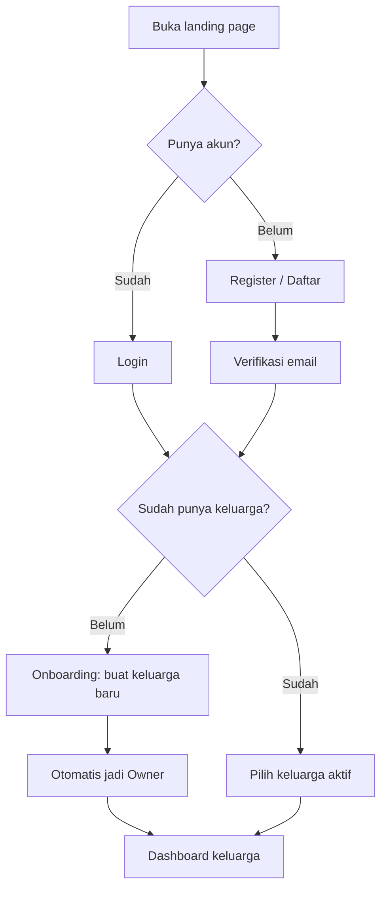
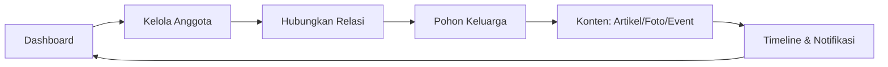
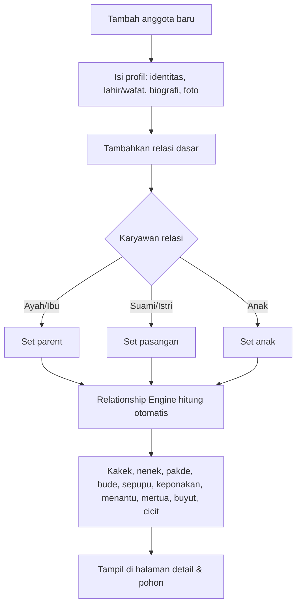
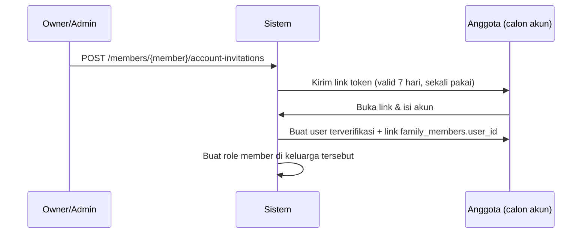
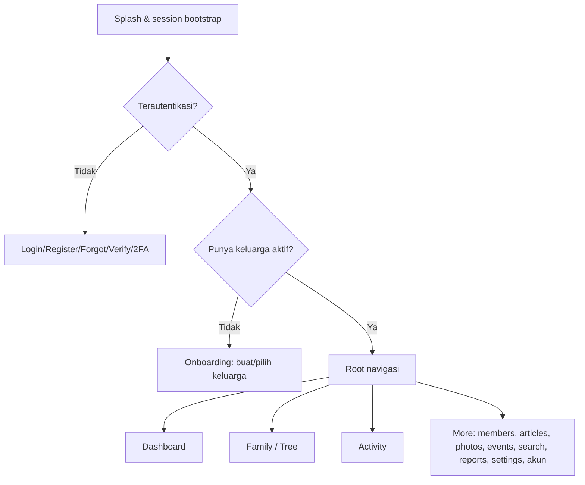

# Flow Penggunaan Aplikasi Family Tree

Dokumen ini menjelaskan alur pemakaian aplikasi dari sisi pengguna, berdasarkan route web (`routes/web.php`), REST API (`routes/api.php`), dan modul yang tersedia pada Phase 1-17.

## Konsep Dasar

- **Akun pengguna** = orang yang bisa login (email + password). Bisa memiliki banyak keluarga.
- **Anggota silsilah (`family_member`)** = orang yang tercatat di pohon keluarga. Bisa ada tanpa akun.
- Satu akun bisa menautkan paling banyak satu profil anggota per keluarga.
- Role (`owner`, `admin`, `member`) berlaku per keluarga. `super-admin` berlaku di tingkat platform.

## 1. Alur Masuk Pertama (Guest -> Owner)

Langkah teknis:

1. `GET /register` -> `POST /register` (`AuthController`).
2. Verifikasi email melalui `GET /email/verify/{id}/{hash}`.
3. `GET /onboarding` -> `POST /onboarding/families` membuat keluarga + membership owner.
4. `POST /families/{family}/activate` menetapkan keluarga aktif (middleware `active.family`).

Login mendukung **2FA** (`/two-factor-challenge`) bila diaktifkan.

## 2. Alur Inti Harian (Web)

Middleware: `auth` + `verified` + `active.family`.

| Halaman | Route | Fungsi |
|---|---|---|
| Dashboard | `GET /dashboard` | Statistik, ulang tahun, event, anggota terbaru |
| Anggota | `GET /members` | List, cari, filter, tambah, edit, detail |
| Relasi | `POST /tree/members/{member}/relatives` | Tambah relasi dasar dari pohon |
| Pohon | `GET /tree` | Ancestor/descendant/full, pan/zoom, export PNG/PDF |
| Pencarian | `GET /search` | Nama, kota, profesi, generasi, hubungan |
| Laporan | `GET /reports` | Statistik & aktivitas keluarga |
| Pengaturan | `GET /settings` | Identitas, cabang, akses/role, export GEDCOM |
| Artikel | `GET /articles` | Tulis, publish, komentar, like |
| Foto | `GET /photos` | Album, upload, tag anggota |
| Event | `GET /events` | Buat acara, RSVP, reminder |
| Timeline | `GET /timeline` | Feed aktivitas keluarga |
| Notifikasi | `GET /notifications` | Inbox + tandai dibaca |

## 3. Alur Membangun Pohon Keluarga

Aturan penting:

- Database hanya menyimpan relasi **ayah, ibu, anak, suami, istri**.
- Istilah turunan dihitung dinamis oleh Relationship Engine (BFS), tidak disimpan.
- Relasi dari UI hanya mengekspos lima tipe dasar tersebut.

## 4. Alur Pohon & Ekspor

1. `GET /tree` pilih mode: **Ancestor**, **Descendant**, atau **Full**.
2. Pilih root member, atur kedalaman (1-20), layout (vertical/horizontal/compact).
3. Gunakan kontrol pan, zoom, center, expand/collapse, search/focus, filter living.
4. **Muat generasi berikutnya** mengambil slice BFS berikutnya (lazy).
5. Export:
   - Web: PNG/PDF via `TreeExportController` (queued, ada progress + download).
   - API: `POST /tree/exports` -> polling `GET /tree/exports/{id}` -> download.

## 5. Alur Kolaborasi & Undangan

### 5a. Mengundang akun ke keluarga (membership)

- Owner/admin: `POST /settings/members` (web) atau `POST /families/{family}/roles/invite` (API).
- Assign role: `PATCH /settings/members/{membership}`; hapus: `DELETE ...`.

### 5b. Menautkan akun ke profil anggota (claim profile)

- Token disimpan hanya sebagai hash SHA-256.
- Satu profil hanya bisa tertaut ke satu akun; satu akun maksimal satu profil per keluarga.
- Anggota yang tertaut dapat mengubah profil & upload fotonya sendiri, tapi tidak bisa menghapus profilnya.

## 6. Alur Konten (Preserve)

- **Artikel**: buat draft -> upload gambar -> publish -> komentar & like. Kategori: sejarah, kisah inspiratif, pengumuman, berita, obituary.
- **Foto**: buat album -> upload -> tag anggota. Album tematik: pernikahan, reuni, lebaran, wisuda, memorial.
- **Event**: buat acara -> RSVP -> daftar hadir/reminder. Jenis: reuni, pernikahan, tahlilan, pengajian, arisan, ulang tahun.
- **Timeline**: agregasi aktivitas (anggota baru, foto, artikel, event, ulang tahun).
- **Notifikasi**: ulang tahun, hari wafat, event, artikel, anggota baru.

## 7. Alur Berdasarkan Role

| Aktivitas | Member | Admin | Owner | Super-admin |
|---|---|---|---|---|
| Lihat silsilah & pohon | Ya | Ya | Ya | Moderasi |
| Ubah profil sendiri | Ya | Ya | Ya | - |
| Tambah/edit anggota & relasi | Terbatas | Ya | Ya | - |
| Kelola artikel/foto/event | Terbatas | Ya | Ya | Moderasi |
| Kelola role & identitas keluarga | Tidak | Sesuai | Ya | - |
| Konsol platform (`/admin`) | Tidak | Tidak | Tidak | Ya |

Konsol super-admin: `/admin` (dashboard), `/admin/users`, `/admin/families`, `/admin/audit-logs`.

## 8. Alur Mobile (Flutter -> REST API)

- Auth: `POST /api/v1/auth/register|login|refresh|logout`, `forgot-password`, `reset-password`, `two-factor-challenge`.
- Keluarga: `GET/POST /families`, `GET /families/{family}/dashboard`.
- Anggota: `family-members`, dokumen, foto, undangan akun, relasi.
- Pohon: `GET /tree/generate`, export PNG/PDF, tree export job.
- Konten: articles, photo-albums, member-photos, events, timeline, notifications, push-devices.
- Insight: search, reports, gamification, leaderboard.
- Business logic seluruhnya di Laravel; Flutter hanya display/input/notifikasi.

## 9. Alur Data Masuk/Keluar

- **Import**: `POST /families/{family}/import/gedcom` (bulk import anggota).
- **Export**: GEDCOM (`/settings/export/gedcom`), CSV anggota (`/families/{family}/members/export`), pohon PNG/PDF.
- **Merge duplikat**: Owner/admin dapat melihat kandidat duplikat (`/members/duplicates`) dan menggabungkan profil.

## 10. Alur Retensi (Engagement)

- Dashboard menampilkan ulang tahun bulan ini & event mendatang.
- Notifikasi push (ulang tahun, hari wafat, event, artikel, anggota baru).
- Gamification: poin, badge, leaderboard (per user & per keluarga).
- Timeline menjaga arsip tetap hidup lintas generasi.
