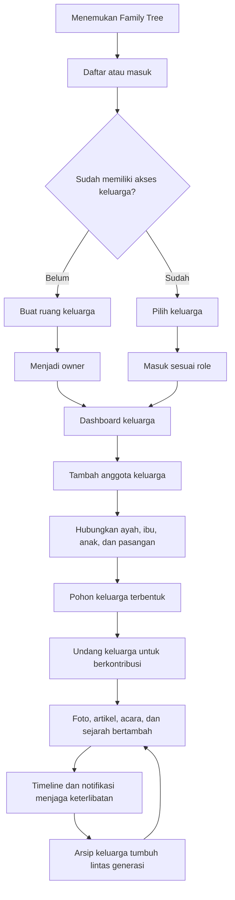
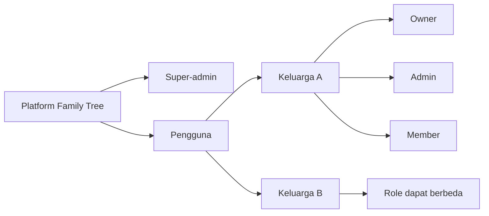
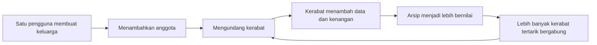

# Family Tree - Product Flow for Investors

## Ringkasan

Family Tree adalah rumah digital keluarga Indonesia untuk membangun silsilah, menyimpan sejarah, mengarsipkan foto, dan menjaga hubungan lintas generasi.

Produk ini memisahkan dua hal penting:

- **Akun pengguna** adalah orang yang dapat masuk ke aplikasi.
- **Anggota silsilah** adalah orang yang tercatat dalam pohon keluarga dan tidak harus memiliki akun.

Dengan struktur ini, satu orang dapat mendokumentasikan leluhur yang sudah wafat, anggota keluarga yang belum memakai aplikasi, maupun kerabat yang nantinya akan diundang untuk berkontribusi.

## Masalah yang Diselesaikan

Informasi keluarga biasanya tersebar di percakapan, album fisik, penyimpanan pribadi, dan ingatan anggota tertua. Ketika tidak dirawat, nama, hubungan, foto, dan sejarah keluarga perlahan hilang.

Family Tree mengubah informasi yang tersebar tersebut menjadi arsip keluarga yang:

- Terstruktur melalui pohon silsilah.
- Dapat dilengkapi bersama oleh keluarga.
- Tetap relevan melalui artikel, foto, acara, dan timeline.
- Aman karena akses dipisahkan per keluarga.
- Dapat berkembang hingga lebih dari 100.000 anggota dalam satu keluarga.

## Siapa yang Menggunakan Family Tree?

| Peran | Posisi | Fungsi utama |
|---|---|---|
| Guest | Publik | Mengenal produk, mendaftar, dan masuk |
| Pengguna baru | Platform | Membuat keluarga atau menerima akses keluarga |
| Member | Per keluarga | Melihat informasi dan berkontribusi sesuai izin |
| Admin | Per keluarga | Mengelola anggota, hubungan, konten, dan acara |
| Owner | Per keluarga | Mengatur identitas keluarga, admin, serta hak akses |
| Super-admin | Platform | Menjaga operasional, keamanan, dan moderasi platform |

`Owner`, `admin`, dan `member` bukan role global. Role tersebut selalu berlaku pada keluarga tertentu. Satu pengguna dapat menjadi owner di Keluarga Santoso, admin di Keluarga Wijaya, dan member di keluarga lainnya.

Super-admin berdiri di tingkat platform dan tidak wajib memiliki keluarga.

## Alur Utama Pengguna

## Pengalaman dari Awal hingga Nilai Utama

### 1. Discover

Calon pengguna memahami bahwa Family Tree bukan hanya pembuat diagram silsilah, tetapi tempat untuk menjaga identitas dan sejarah keluarga.

### 2. Activate

Pengguna mendaftar, lalu:

- Membuat keluarga baru dan otomatis menjadi owner.
- Memilih keluarga jika sudah mendapat akses.
- Berpindah keluarga jika memiliki lebih dari satu keanggotaan.

### 3. Build

Owner atau admin mulai memasukkan anggota keluarga dan hubungan dasar:

- Ayah.
- Ibu.
- Anak.
- Suami.
- Istri.

Hubungan seperti kakek, nenek, paman, bibi, sepupu, keponakan, mertua, dan menantu dihitung otomatis oleh Relationship Engine. Sistem tidak menyimpan istilah turunan tersebut secara manual sehingga data tetap konsisten.

### 4. Preserve

Pohon keluarga diperkaya dengan:

- Biografi dan informasi anggota.
- Foto profil dan album keluarga.
- Artikel sejarah atau cerita keluarga.
- Acara dan agenda keluarga.
- Timeline aktivitas.

### 5. Collaborate

Owner mengundang pengguna lain sebagai member atau admin. Setiap kontribusi memperkaya arsip yang sama tanpa memindahkan data ke aplikasi lain.

### 6. Retain

Ulang tahun, acara mendatang, notifikasi, aktivitas terbaru, laporan, dan leaderboard memberi alasan bagi pengguna untuk kembali, bukan hanya membuka aplikasi satu kali ketika membuat pohon.

## Alur Berdasarkan Role

| Aktivitas | Member | Admin | Owner | Super-admin |
|---|:---:|:---:|:---:|:---:|
| Melihat keluarga yang diizinkan | Ya | Ya | Ya | Moderasi |
| Berkontribusi pada konten | Sesuai izin | Ya | Ya | Tidak sebagai default |
| Mengelola anggota dan hubungan | Terbatas | Ya | Ya | Tidak sebagai default |
| Mengelola artikel, foto, dan acara | Terbatas | Ya | Ya | Moderasi |
| Mengatur identitas keluarga | Tidak | Sesuai kebijakan | Ya | Tidak |
| Mengelola role keluarga | Tidak | Sesuai kebijakan | Ya | Tidak |
| Mengelola seluruh platform | Tidak | Tidak | Tidak | Ya |

## Mesin Pertumbuhan Produk

Setiap keluarga membentuk jaringan privatnya sendiri. Nilai produk meningkat ketika lebih banyak kerabat berkontribusi, sementara undangan keluarga menjadi saluran akuisisi organik.

## Kapabilitas Produk Saat Ini

- Autentikasi web dan REST API untuk mobile.
- Onboarding, pembuatan, pemilihan, dan penggantian keluarga aktif.
- Role owner, admin, dan member yang terisolasi per keluarga.
- Manajemen anggota dan cabang keluarga.
- Relationship Engine untuk hubungan kekerabatan.
- Family Tree Generator untuk ancestor, descendant, dan full tree.
- Artikel, album foto, acara, timeline, pencarian, dan notifikasi.
- Dashboard, statistik, laporan, gamification, dan leaderboard.
- Pengaturan nama, deskripsi, kota asal, logo, cover, dan privasi keluarga.
- Konsol super-admin untuk moderasi dan audit.
- Arsitektur web dan mobile dengan Laravel sebagai sumber aturan bisnis.

## Diferensiasi

- **Family-first:** data dan akses dipisahkan secara ketat per keluarga.
- **Indonesia-first:** pengalaman dirancang untuk struktur dan istilah keluarga Indonesia.
- **Relationship intelligence:** hubungan turunan dihitung otomatis melalui graph traversal.
- **Beyond a tree:** silsilah terhubung dengan foto, artikel, acara, dan sejarah.
- **Collaborative archive:** akun pengguna dan anggota silsilah dipisahkan agar dokumentasi tidak bergantung pada adopsi semua anggota.
- **Built for scale:** desain sistem menargetkan lebih dari 100.000 anggota per keluarga.

## Pengembangan Berikutnya

Bagian ini adalah arah pengembangan, bukan kapabilitas yang sudah tersedia:

- Tema visual berbeda untuk setiap keluarga.
- Pilihan paket penyimpanan dan kapasitas anggota.
- Cetak buku keluarga dan ekspor premium.
- Restorasi foto keluarga berbantuan AI.
- Peta persebaran keluarga.
- Arsip suara dan cerita anggota senior.
- Memorial serta QR untuk menghubungkan lokasi fisik ke profil keluarga.

## Peluang Model Bisnis

Model berikut merupakan opsi yang dapat diuji melalui validasi pasar:

| Paket | Target | Nilai yang ditawarkan |
|---|---|---|
| Gratis | Keluarga baru | Pohon dasar dan kolaborasi terbatas |
| Family Plus | Keluarga aktif | Kapasitas media, ekspor, tema, dan fitur arsip lebih besar |
| Family Heritage | Keluarga besar | Arsip premium, buku keluarga, serta pengelolaan banyak cabang |
| Institusi | Komunitas atau yayasan | Kapasitas besar, administrasi, migrasi data, dan dukungan khusus |

## Metrik yang Relevan untuk Investor

- Jumlah keluarga yang berhasil diaktifkan.
- Jumlah anggota silsilah yang terdokumentasi.
- Rata-rata pengguna aktif per keluarga.
- Rasio undangan menjadi pengguna aktif.
- Kontribusi foto, artikel, anggota, dan acara per keluarga.
- Retensi keluarga dalam 30 dan 90 hari.
- Penggunaan tree viewer dan ekspor.
- Konversi keluarga aktif ke paket berbayar.
- Pertumbuhan kapasitas arsip per keluarga.

## Narasi Singkat untuk Pitch

> Family Tree membantu keluarga Indonesia menjaga nama, hubungan, dan cerita lintas generasi. Pengguna membangun silsilah, mengundang kerabat, lalu bersama-sama mengisi foto, sejarah, dan peristiwa keluarga. Semakin banyak keluarga berkontribusi, semakin bernilai arsip tersebut dan semakin kuat alasan mereka untuk terus menggunakan Family Tree.

